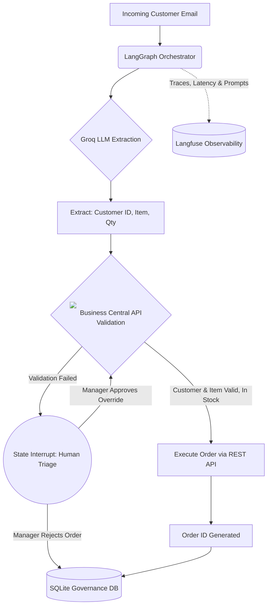

# Agentic Order Processing System

**An AI-driven Agentic workflow for automating unstructured order ingestion.**
Powered by LangGraph and Groq LLMs, this system dynamically extracts order parameters from raw customer emails, performs real-time inventory and customer validation against Microsoft Dynamics 365 Business Central, and routes exceptions to a Human-in-the-Loop (HITL) triage interface. Full execution observability is maintained via Langfuse alongside a persistent SQLite audit log for central governance.

## 🎥 Watch Project Demo Video

<div align="center">
  <a href="https://www.youtube.com/watch?v=bB50z1cjoiY" target="_blank" rel="noopener noreferrer">
    
  </a>
  <br/>
  <p><b>▶️ Click the image above to watch the full 1080p HD demo video on YouTube</b></p>
</div>

## Key Features

* **Automated Data Extraction:** Uses Groq's low-latency LLMs (Llama 3.1 8B) to structure unstructured email requests into strict Pydantic schemas.
* **Real-time ERP Validation:** Connects to Microsoft Dynamics 365 Business Central via MSAL OAuth 2.0 to dynamically verify customer accounts, item existence, and stock availability.
* **Human-in-the-Loop (HITL) Triage:** Graph execution automatically pauses when encountering business logic failures (e.g., invalid customer, missing item, insufficient inventory) and hands control to a human operator for overrides or rejections.
* **Central Governance & Traceability:** Logs complete execution flows, node latency, and prompt interactions to Langfuse.
* **Historical Audit Database:** Automatically logs all successful, rejected, and triaged orders into a local SQLite database for compliance and analytics.

---

## Architecture



---

## Technology Stack

* **LLM Inference:** Groq API (Llama-3.1-8b-instant)
* **Orchestration:** LangGraph (Stateful AI workflow management with MemorySaver)
* **Frontend / UI:** Streamlit (Python-based interactive dashboard)
* **ERP Backend:** Microsoft Dynamics 365 Business Central (REST API)
* **Authentication:** MSAL (Microsoft Authentication Library for Entra ID)
* **Observability:** Langfuse (Execution tracing, node latency, and performance monitoring)
* **Database:** SQLite3 & Pandas (Local, persistent audit logging)

---

## Project Structure

```text
Manufacturing_Agent/
├── .env                          # Environment variables and API keys (Do not commit)
├── requirements.txt              # Python dependencies
├── bc_integration.py             # MSAL Auth & Business Central REST API logic (Customer & Item Validation)
├── agent.py                      # LangGraph state machine, validation routing, and node definitions
├── app.py                        # Streamlit UI, session state, UI tabs, and database manager
├── orders_log.db                 # SQLite database generated at runtime for historical audit logs
└── assets/                       
    ├── d365businesscentral.svg   # Primary vector logo for UI and architecture
    └── d365businesscentral.png   # High-res fallback logo for dashboard header

```

---

## Prerequisites

1. **Python 3.10+** installed on your local machine.
2. **Groq API Key**: Available at [console.groq.com](https://console.groq.com/).
3. **Langfuse Account**: Available at [cloud.langfuse.com](https://cloud.langfuse.com/).
4. **Dynamics 365 Business Central Sandbox**:
* Must have the CRONUS demo data installed.
* Registered App in Microsoft Entra ID with `API.ReadWrite.All` permissions.
* Access to Client ID, Client Secret, and Tenant ID.


---

## Local Installation & Setup

1. **Clone the repository:**

```bash
git clone https://github.com/yourusername/Manufacturing_Agent.git
cd Manufacturing_Agent

```

2. **Create and activate a virtual environment:**

```bash
python -m venv venv
source venv/Scripts/activate  # On Windows Git Bash
# source venv/bin/activate    # On macOS/Linux

```

3. **Install the dependencies:**

```bash
pip install -r requirements.txt

```

4. **Configure Environment Variables:**
Create a `.env` file in the root directory and populate it with the following credentials:

```env
# AI & Observability
GROQ_API_KEY="your_groq_api_key_here"
LANGFUSE_PUBLIC_KEY="your_langfuse_public_key"
LANGFUSE_SECRET_KEY="your_langfuse_secret_key"
LANGFUSE_HOST="https://cloud.langfuse.com"

# Dynamics 365 Business Central Authentication
BC_TENANT_ID="your_tenant.onmicrosoft.com"
BC_CLIENT_ID="your_entra_client_id"
BC_CLIENT_SECRET="your_entra_client_secret"
BC_ENVIRONMENT="Sandbox"
BC_COMPANY_ID="your_cronus_company_id"

```

---

## Running the Application

Execute the Streamlit application from your terminal:

```bash
streamlit run app.py

```

Navigate to `http://localhost:8501` in your browser.

---

## Dashboard Overview

The application features a four-tab layout designed for operational transparency and governance:

### 1. 🤖 Agent Workflow

* **System Transparency:** Includes an expander documenting the exact graph orchestration steps, LLM extraction prompt, and specific Business Central API endpoints targeted.
* **Email Simulation:** Allows operators to edit raw email text. Purposefully inputting an invalid customer account or product code will immediately trigger the system's human-in-the-loop safeguards.
* **Human Triage Interface:** When the graph interrupts due to failed Business Central validation, operators are presented with dynamic drop-downs to override customer IDs or product codes, or definitively reject the order.

### 2. 📦 Processed Order Summary

* Displays the final extraction parameters, the generated Business Central Order ID, and visual warnings if any human overrides were applied during the triage phase.

### 3. 🔍 Governance & Traceability

* Renders a chronological "Block Flow" timeline of the exact node execution path.
* Pulls JSON metadata via the Langfuse SDK/API to display latency metrics, node start/end times, and LangGraph observation IDs directly within Streamlit.

### 4. 🏛️ Global Order Governance & Audit

* Connects directly to the persistent `orders_log.db` SQLite database.
* Provides a Pandas-powered interactive dataframe showing the entire history of processed orders, categorizing executions by status (`SUCCESS`, `REJECTED`), applied triage categories, and timestamp.

---

## Future Enhancements

* **Live Ingestion Setup:** Replace the UI-based email simulator with an `imaplib` listener or Microsoft Graph API webhook to ingest live inbox requests.
* **Database Expansion:** Upgrade the local SQLite instance to PostgreSQL if transitioning to a fully cloud-hosted, multi-tenant production environment.
